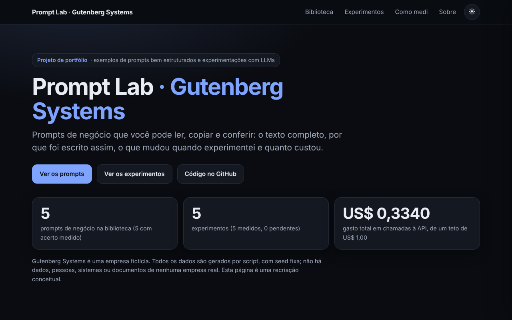

# Prompt Lab · Gutenberg Systems

**Prompts de negócio que você pode ler, copiar e conferir: o texto completo, por que foi escrito assim, o que mudou quando experimentei e quanto custou.**

[](https://prodigyb0y.github.io/prompt-engineering/)

**Demo (sem instalação e sem chave): https://prodigyb0y.github.io/prompt-engineering/** · [versão para celular](docs/img/demo-mobile.png)

Projeto de portfólio com exemplos de prompts bem estruturados e experimentações com LLMs. É uma **recriação conceitual com dados 100% fictícios**: Gutenberg Systems é uma empresa fictícia. Todos os dados são gerados por script, com seed fixa; não há dados, pessoas, sistemas ou documentos de nenhuma empresa real.

## O que este projeto mostra

- **Prompts bem estruturados:** cinco prompts de negócio, cada um com papel, contexto, tarefa, formato de saída, regras e casos de borda, e uma técnica em destaque.
- **Experimentos com LLM:** cinco comparações curtas (técnica, antes e depois, few-shot, encadear, raciocínio), cada uma com o que foi testado, o resultado e quando usar.
- **Decisões com custo medido:** acerto contra um gabarito escrito antes de rodar, custo por chamada e teto de gasto no código (gasto até aqui: US$ 0,3340 de US$ 1,00).

## Biblioteca de prompts

| # | Prompt (problema de negócio) | Técnica em destaque | Acerto | Custo por chamada | Arquivo |
|---|---|---|---|---|---|
| P1 | **Extrair pedido de compra em 8 campos**. O time de compras recebe pedidos em texto livre ("preciso de 10 caixas de papel A4, entrega até dia 15...") e redigita tudo à mão em um sistema. | System prompt e saída estruturada | 100,0% (desenvolvimento) | US$ 0,000145 | [`prompts/P1_system_prompt_v2.json`](prompts/P1_system_prompt_v2.json) |
| P2 | **Classificar solicitação de suporte interno**. Pedidos de suporte interno chegam sem padrão. Alguém precisa decidir para qual fila vão e com que prioridade. | Few-shot com casos ambíguos | 98,3% | US$ 0,000137 | [`prompts/P2_few_shot_v1.json`](prompts/P2_few_shot_v1.json) |
| P3 | **E-mail pedindo só os campos que faltaram**. Quando o pedido chega incompleto, alguém escreve um e-mail pedindo o que falta, e às vezes pede o que já foi informado. | Prompt encadeado e controle de tom | 78,3% | US$ 0,000256 | [`prompts/P3_encadeado_v1.json`](prompts/P3_encadeado_v1.json) |
| P4 | **Resumir reclamação de cliente em JSON**. Reclamações longas precisam virar um resumo estruturado para o atendimento decidir o próximo passo, sem que o resumo invente número de pedido ou valor. | Saída estruturada com regras de não inventar | 95,0% | US$ 0,000219 | [`prompts/P4_saida_estruturada_v1.json`](prompts/P4_saida_estruturada_v1.json) |
| P5 | **Decidir a próxima etapa da solicitação**. Depois da extração, alguém aplica a política de compras (campos obrigatórios, limite de valor, fornecedor homologado) para decidir a próxima etapa. | Chain-of-thought com raciocínio separado da saída | 100,0% | US$ 0,000278 | [`prompts/P5_chain_of_thought_v1.json`](prompts/P5_chain_of_thought_v1.json) |

O acerto de cada prompt é medido contra um gabarito escrito e congelado (hash) antes de rodar; o do P1 foi medido nos mesmos 50 casos em que a regra foi escrita. A regra de acerto de cada prompt está em [`src/avaliadores.py`](src/avaliadores.py). Cada cartão da demo mostra o prompt completo, as partes coloridas, um exemplo de entrada e saída e o que aprendi.

## O prompt P1 completo (T4 v2, hash `2c3ccc1873da`)

System prompt:

```text
Você é um assistente de extração de dados do setor de compras da Gutenberg Systems, empresa fictícia.
Sua única tarefa é ler uma solicitação de compra em texto livre e devolver um objeto JSON.

Campos do JSON (use exatamente estes nomes, sem campos extras):
- solicitante_area: string ou null
- item: string
- quantidade: número
- unidade: um de "un", "kg", "m", "l", "cx"
- prazo_entrega: data no formato AAAA-MM-DD ou null
- valor_unitario: número ou null
- moeda: "BRL", "USD", "EUR" ou null
- fornecedor: string ou null

Regras:
- Responda somente com o objeto JSON, sem explicações e sem formatação extra.
- Se uma informação não estiver no texto, use null. Não invente valores.
- quantidade é a quantidade do item pedido; ignore outras quantidades citadas no texto (estoque, pedidos anteriores).
- valor_unitario é um número puro, sem símbolo. Entenda separadores brasileiros: "R$ 1.200,00" é 1200 e "R$ 12,50" é 12.5.
- moeda vem do símbolo: R$ = "BRL", US$ = "USD", € = "EUR". Sem nenhum valor no texto (nem unitário, nem total), valor_unitario e moeda são null.
- Se o texto trouxer só o valor total, e não o valor unitário, divida o total pela quantidade para obter valor_unitario. A moeda é a do total.
- prazo_entrega só recebe data quando o texto traz uma data completa com dia, mês e ano. Converta para AAAA-MM-DD. Prazos relativos ("daqui 15 dias", "semana que vem") viram null.
- fornecedor: copie o nome como aparece no texto, mesmo que seja um apelido.
- Ignore ruído, saudações, assinaturas e erros de digitação.
```

Mensagem do usuário (o `{texto}` recebe o pedido):

```text
Solicitação:
{texto}
```

Anatomia comentada:

| Parte | Trecho do prompt | Para que serve |
|---|---|---|
| Papel | `Você é um assistente de extração de dados` | Define quem responde: um extrator, não um conversador. |
| Contexto | `do setor de compras da Gutenberg Systems, empresa fictícia.` | Situa o modelo no negócio; ajuda a interpretar abreviações e apelidos de fornecedor. |
| Tarefa | `Sua única tarefa é ler uma solicitação de compra em texto livre e devolver um ob…` | Uma tarefa só, dita de forma direta. O "única" corta respostas com conversa. |
| Formato de saída | `Campos do JSON (use exatamente estes nomes, sem campos extras): - solicitante_ar…` | Os 8 campos, com tipo e valores permitidos. Sem isso o JSON sairia diferente a cada chamada. |
| Regras | `- Responda somente com o objeto JSON, sem explicações e sem formatação extra.` | Torna a saída legível por código, sem limpeza. |
| Regras | `- Se uma informação não estiver no texto, use null. Não invente valores.` | Evita invenção: campo ausente vira null, não um palpite. |
| Casos de borda | `- quantidade é a quantidade do item pedido; ignore outras quantidades citadas no…` | Caso de borda: duas quantidades no mesmo texto. |
| Casos de borda | `- Se o texto trouxer só o valor total, e não o valor unitário, divida o total pe…` | As duas linhas da iteração v1 → v2: a regra de negócio que faltava (ver Experimento 2). |
| Casos de borda | `Prazos relativos ("daqui 15 dias", "semana que vem") viram null.` | Caso de borda: data que não é data. |

## Antes e depois de um prompt

**Duas linhas acrescentadas ao prompt levaram o acerto de 92,0% para 100,0%, sem regressão e com custo por resposta menor.**

Placar no tipo "valor total" (respostas certas): **0/12 → 12/12**. O que mudou no prompt (T4 v1 → v2):

```diff
  …
  - valor_unitario é um número puro, sem símbolo. Entenda separadores brasileiros: "R$ 1.200,00" é 1200 e "R$ 12,50" é 12.5.
- - moeda vem do símbolo: R$ = "BRL", US$ = "USD", € = "EUR". Sem valor no texto, valor_unitario e moeda são null.
+ - moeda vem do símbolo: R$ = "BRL", US$ = "USD", € = "EUR". Sem nenhum valor no texto (nem unitário, nem total), valor_unitario e moeda são null.
+ - Se o texto trouxer só o valor total, e não o valor unitário, divida o total pela quantidade para obter valor_unitario. A moeda é a do total.
  - prazo_entrega só recebe data quando o texto traz uma data completa com dia, mês e ano. Converta para AAAA-MM-DD. Prazos relativos ("daqui 15 dias", "semana que vem") viram null.
```

Ressalva: A regra nova foi escrita depois de ver os erros nesses mesmos 50 casos. É resultado de desenvolvimento: mostra o ciclo medir, diagnosticar, corrigir e medir de novo, mas não prova que a regra vale para casos novos (isso ainda não foi testado).

## Experimentos

**E1 · Qual técnica usar na extração?** — Em 46 de 50 casos todas as técnicas acertaram; a diferença apareceu só quando a regra de negócio (calcular o valor unitário a partir do total) não estava escrita no prompt.
Quando usar: Em extração simples, comece pelo prompt mais barato e escreva as regras de negócio dentro dele. O raciocínio passo a passo custou 2,8 vezes mais por resposta que o zero-shot; a vantagem numérica dele apareceu só onde havia cálculo implícito, e esse caso a regra escrita resolveu (Experimento 2).

**E2 · Antes e depois de um prompt** — Duas linhas acrescentadas ao prompt levaram o acerto de 92,0% para 100,0%, sem regressão e com custo por resposta menor.
Quando usar: Quando um tipo de erro se repete, leia os erros, escreva a regra que falta no prompt e rode de novo no mesmo conjunto para conferir que nada piorou. Depois valide em casos que a regra nunca viu (ainda não feito).

**E3 · Few-shot ajuda na classificação?** — "Few-shot" acertou 98,3% contra 91,7% de "Zero-shot" (6,7 pontos a mais): melhor em 2 casos e pior em 1. A variante "Few-shot" custou 1,9 vezes o custo por resposta (US$ 0,000137 contra US$ 0,000073). Com 20 casos isso é um indício, não uma prova (teste pareado: p = 1,000).
Quando usar: Use exemplos quando as definições não resolvem os empates: escolha exemplos que ensinem a convenção dos casos ambíguos.

**E4 · Encadear ou pedir tudo de uma vez?** — "Encadeado (P1 → P3)" acertou 78,3% contra 81,7% de "Prompt único (extrai e escreve)" (3,3 pontos a menos): pior em 6 casos e melhor em 4. A variante "Encadeado (P1 → P3)" custou 0,9 vez o custo por resposta (US$ 0,000256 contra US$ 0,000270). Com 20 casos isso é um indício, não uma prova (teste pareado: p = 0,754).
Quando usar: O prompt único acertou mais neste conjunto: prefira-o, a menos que precise auditar a etapa intermediária.

**E5 · Vale pagar pelo raciocínio?** — "Com raciocínio (chain-of-thought)" acertou 100,0% contra 95,0% de "Sem raciocínio" (5,0 pontos a mais): melhor em 1 casos e pior em 0. A variante "Com raciocínio (chain-of-thought)" custou 2,3 vezes o custo por resposta (US$ 0,000278 contra US$ 0,000123). Com 20 casos isso é um indício, não uma prova (teste pareado: p = 1,000).
Quando usar: Vale pagar pelo raciocínio quando a decisão exige conta ou precedência entre regras; compare o ganho com o custo antes de adotar.

## Por que isso importa para um time de negócio

1. **A regra de negócio vale mais que a técnica.** Em 46 de 50 casos todas as técnicas acertaram; a diferença apareceu só quando a regra de negócio (calcular o valor unitário a partir do total) não estava escrita no prompt. Escrever a regra no prompt resolveu o que a técnica mais cara resolvia (Experimento 2).
2. **Prompt é um artefato que se versiona e se testa.** Cada prompt tem versão e hash, o gabarito é congelado antes de rodar e a regra de acerto é código: dá para mudar o prompt e saber se piorou.
3. **Custo medido, não suposto.** Cada resposta tem o custo calculado a partir dos tokens informados pela API, e o cliente para antes de passar do teto. Isso permite decidir se uma técnica mais cara compensa, com número.

## Limitações

- Dados 100% fictícios e gerados por script: mais regulares do que e-mails e chamados reais.
- Um único modelo (claude-haiku-5-5), com esforço de raciocínio fixado em baixo; ele não aceita temperatura 0.
- O gabarito foi escrito pelo autor do projeto, sem segunda pessoa conferindo; nos casos ambíguos ele reflete convenções minhas.
- Poucos casos: 50 na extração e 20 em cada prompt novo. Diferenças de poucos casos são indício, não prova.
- A regra do T4 v2 foi escrita olhando os mesmos casos em que foi medida (resultado de desenvolvimento).
- A comparação entre as técnicas do E1 usou prompts v1; o T4 v2 foi o único ajustado, então a comparação entre ele e as outras não é simétrica.
- Não verifiquei se algum nome de fornecedor fictício coincide com empresa real (só conferi uma lista curta de nomes conhecidos).

## Como rodar

```bash
git clone https://github.com/Prodigyb0y/prompt-engineering
cd prompt-engineering
python -m venv .venv && .venv/bin/pip install -r requirements.txt     # Windows: .venv\Scripts\python.exe -m pip ...
.venv/bin/python -m pytest -q                     # testes que não chamam a API
cp .env.example .env                              # preencha ANTHROPIC_API_KEY (nunca versione o .env)
.venv/bin/python src/rodar_biblioteca.py --piloto      # 5 chamadas por prompt novo
.venv/bin/python src/rodar_biblioteca.py --completo    # E3, E4, E5 e P4 (retomável; teto próprio de US$ 0,60)
.venv/bin/python src/analisar_biblioteca.py && .venv/bin/python src/consolidar.py   # resultados/resumo.json
.venv/bin/python src/gerar_demo.py && .venv/bin/python src/gerar_docs.py             # docs/index.html, README.md e docs/medicao.md
```

A chave só existe em `.env` ou na variável `ANTHROPIC_API_KEY`. O modelo não aceita temperatura, então quem refizer as rodadas pode obter números diferentes. Rodadas antigas (extração v1 e v2): comandos em [`docs/medicao.md`](docs/medicao.md).

## Estrutura

```
prompts/            P1 a P5 e os controles dos experimentos (versão, hash e anatomia)
prompts/extracao/   T1 a T4 (v1) e T4 v2 da extração
dados/biblioteca/   casos e gabaritos de P2 a P5 (20 casos cada), hashes e revisão
dados/extracao/     v1 e v2: 50 casos cada, gabarito, exemplos few-shot, hashes
resultados/         resumo.json (alimenta a demo), extracao/ (v1, v2 e iteração), biblioteca/ (rodadas novas)
src/                geradores, validadores, avaliadores, cliente com teto de gasto, análise, demo, documentação
tests/              testes que não chamam a API
docs/               index.html (demo), medicao.md (apêndice), checklist_entrega.md, img/, legado/
```

## Apêndice

Bootstrap, teste do sinal pareado, auditoria e a rodada v1 estão em [**Detalhes da medição**](docs/medicao.md).
